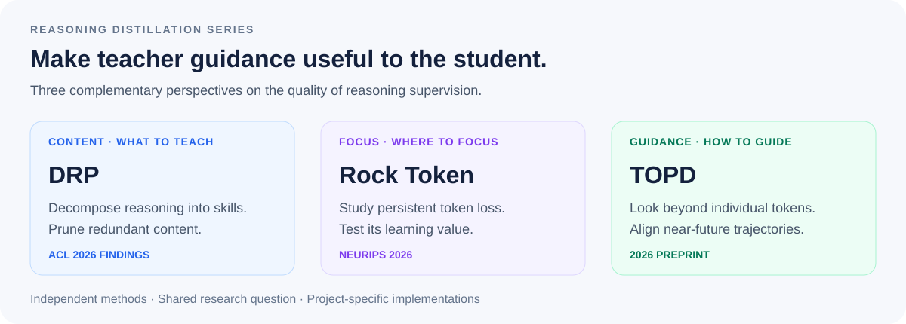

<div align="center">

# Reasoning Distillation
### Better supervision for reasoning models

**DRP · Rock Token · TOPD**

A research series on **what to teach, where to focus, and how to guide** a student model.

[](https://aclanthology.org/2026.findings-acl.196/)
[](https://arxiv.org/abs/2605.09253)
[](https://arxiv.org/abs/2606.00305)

[Project guide](#choose-a-project) · [Research story](#one-question-three-perspectives) · [Results](#selected-findings) · [Getting started](#getting-started) · [Citations](citations.bib)

</div>

<p align="center"></p>

## One question, three perspectives

**How can a teacher provide supervision that a student can actually benefit from?**

Reasoning distillation involves more than copying a solution. The structure of the reasoning trace, the value of individual learning signals, and the compatibility of teacher guidance with the student's trajectory all matter.

This series investigates these questions through three complementary projects:

- **DRP — What to teach.** Use skill-aware decomposition and pruning to refine reasoning traces before distilling them into a student.
- **Rock Token — Where to focus.** Investigate persistent high-loss tokens and test whether large student–teacher disagreements translate into useful learning.
- **TOPD — How to guide.** Use near-future trajectory information to identify meaningful divergence and guide the student beyond isolated token corrections.

Each project is an independent method with its own experiments. DRP covers reasoning-trace refinement and distillation; Rock Token and TOPD study on-policy distillation. The series provides a shared research map rather than a single combined training algorithm.

## Choose a project

| Your goal | Project | Resources | Status |
|---|---|---|---|
| Refine reasoning traces and reduce redundant reasoning | **[DRP](DRP/)** | [Paper](https://aclanthology.org/2026.findings-acl.196/) · [Code](https://github.com/YuxuanJiang1/DRP) | ACL 2026 Findings; code available |
| Analyze persistent token losses and selective supervision | **[Rock Token](Rock-Token/)** | [Paper](https://arxiv.org/abs/2605.09253) · [Code](https://github.com/YuxuanJiang1/Rock-Token) | Accepted to NeurIPS 2026; code available |
| Improve online teacher guidance when reasoning paths diverge | **[TOPD](TOPD/)** | [Paper](https://arxiv.org/abs/2606.00305) · [Method guide](TOPD/) | Preprint; implementation not included in this hub |

## Selected findings

Results below come from each project's own experimental setup; they are not a shared leaderboard.

| Project | Finding | Reported evidence |
|---|---|---|
| **DRP** | Refined reasoning can be shorter and more accurate | On GSM8K, average tokens **917 → 328**, accuracy **91.7% → 94.1%** |
| **Rock Token** | Persistent high loss is not sufficient to establish learning value | Checkpoint, gradient, and intervention analyses distinguish persistent mismatch from functional contribution |
| **TOPD** | Near-future guidance improves over local OPD correction | Average accuracy **47.8% → 52.2%**; AIME25 **46.7% → 53.3%** |

Sources: [DRP published paper](https://aclanthology.org/2026.findings-acl.196/), [Rock Token paper](https://arxiv.org/abs/2605.09253), and [TOPD preprint](https://arxiv.org/abs/2606.00305).

### From persistent mismatch to trajectory guidance

<p align="center"></p>

*Rock Token: inspect how token losses and gradients evolve before interpreting high loss as useful supervision.*

<p align="center"></p>

*TOPD: a conceptual example of using teacher continuations to guide the student's future trajectory. This is a method illustration, not a measured execution trace.*

## Getting started

Start with the project that matches your question. The existing code repositories remain the canonical implementation locations, with their own dependencies and setup instructions.

```bash
# Reasoning decomposition, pruning, and distillation
git clone https://github.com/YuxuanJiang1/DRP.git

# Token analysis, OPD training, and selective masking
git clone https://github.com/YuxuanJiang1/Rock-Token.git
```

- **DRP:** follow the [project setup](https://github.com/YuxuanJiang1/DRP#-get-started) and inspect the decomposition, training, and evaluation scripts. Check the upstream repository for data availability.
- **Rock Token:** follow the [public usage guide](https://github.com/YuxuanJiang1/Rock-Token/blob/main/docs/USAGE.md). Supply your own checkpoint and dataset paths; the paper's private checkpoint presets are not a public weight release.
- **TOPD:** the [method guide](TOPD/) links the paper and explains the approach. This hub does not yet provide a runnable TOPD release.

## Repository layout

```text
Reasoning-Distillation/
├── DRP/                 # Project overview and implementation entry points
├── Rock-Token/          # Project overview and implementation entry points
├── TOPD/                # Method overview and paper
├── assets/              # Series diagram and paper illustrations
└── citations.bib        # Individual paper citations
```

## Related direction: reusable reward evaluation

**[SCRIBE](https://github.com/YuxuanJiang1/SCRIBE)** studies reusable skill rubrics for process reward models and LLM-as-a-Judge evaluation. It remains a standalone project, with its own presentation materials and release status.

## People and citation

This series brings together work by [Yuxuan Jiang](https://yuxuanjiang1.github.io/) and collaborators. Each project page lists its paper's authors. Please cite the individual methods you use; the BibTeX entries are collected in [citations.bib](citations.bib).

Questions and suggestions: [open an issue](https://github.com/YuxuanJiang1/Reasoning-Distillation/issues).

## Licensing and provenance

This hub contains project documentation and research figures. Linked implementations retain their own licensing terms; this hub does not relicense them. Figure provenance is documented in [assets/README.md](assets/README.md).
