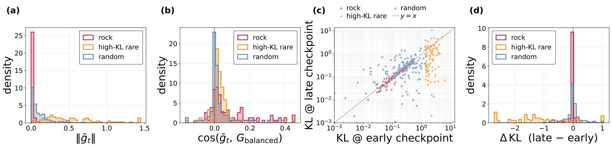

# Rock Token · Where to focus

**Cornerstones or Stumbling Blocks? Deciphering the Rock Tokens in On-Policy Distillation**
Yuxuan Jiang, Runchao Li, Shubhashis Roy Dipta, Dawei Li, Zhao Yang · **Accepted to NeurIPS 2026**

[Paper](https://arxiv.org/abs/2605.09253) · [Implementation](https://github.com/YuxuanJiang1/Rock-Token) · [Series overview](../README.md)

Rock Token investigates tokens whose distillation loss persists as training progresses. Through gradient analysis, checkpoint comparisons, and interventions, it examines whether persistent mismatch indicates useful supervision.

## Workflow

```text
Collect token statistics → Identify persistent mismatch → Analyze contribution → Test selective supervision
```



## Use the implementation

```bash
git clone https://github.com/YuxuanJiang1/Rock-Token.git
cd Rock-Token
```

Follow the [public usage guide](https://github.com/YuxuanJiang1/Rock-Token/blob/main/docs/USAGE.md). The repository contains token analysis, KDFlow-based distillation, selective masking, and evaluation scripts. Trained checkpoints and original training files are not bundled; configure model and data paths before running.

The paper's arXiv citation is retained until final proceedings metadata is available.
