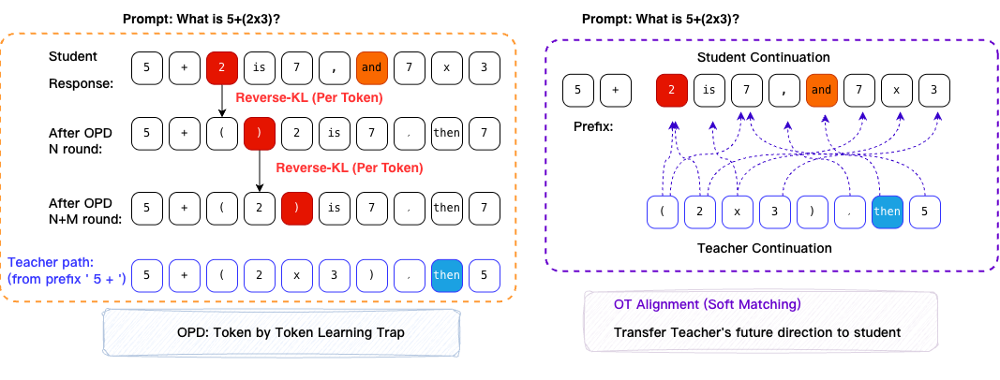

# TOPD · How to guide

**Bridging Reasoning Trajectories in On-Policy Distillation via Near-Future Guidance**
Yuxuan Jiang, Francis Ferraro · **2026 preprint**

[Paper](https://arxiv.org/abs/2606.00305) · [Series overview](../README.md)

Trajectory-aware OPD (TOPD) uses near-future information to distinguish meaningful reasoning divergence from surface mismatch and spread teacher guidance across future tokens.



*Conceptual illustration from the authors' paper materials.*

## Workflow

```text
Student trajectory → Inspect near-future divergence → Align continuations → Distribute teacher guidance
```

The preprint reports average accuracy of 52.2%, compared with 47.8% for standard OPD, and AIME25 accuracy of 53.3%, compared with 46.7%. Refer to the paper for models, benchmark composition, and evaluation settings.

## Release status

This directory provides a paper and method entry point. A runnable TOPD implementation, model weights, and training datasets are not included in this hub. DRP and Rock Token have separate implementation links on the series homepage.
